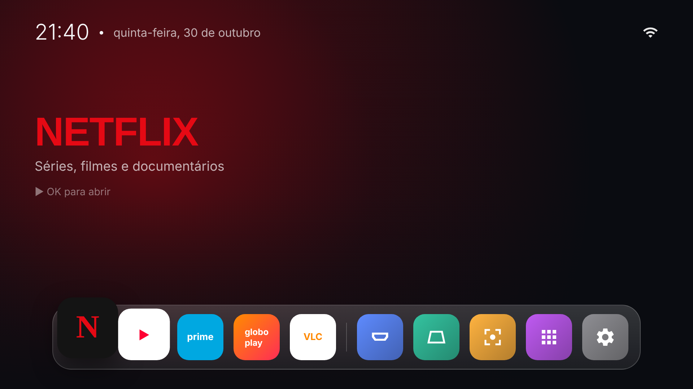

# Launcher Cinema

Tela inicial própria para o HY300 Pro, no estilo **híbrido Android TV + macOS**:



*Prévia do layout. No aparelho aparecem os ícones e banners reais de cada app.*

- **Destaque grande** do app em foco (banner oficial do app quando existir), com brilho na cor do app.
- **Dock de vidro** com zoom no item em foco e nos vizinhos, como o dock do macOS.
- **Atalhos do projetor** no próprio dock: HDMI, Imagem (keystone), Foco, Todos os apps e Ajustes. Atalhos que não existem no firmware somem sozinhos.
- **Leve**: Kotlin puro, sem AndroidX nem bibliotecas, pensado para 1 GB de RAM. Nenhuma permissão além do estado da rede.
- Tecla **Menu** do controle: abre Todos os apps. Em Todos os apps, **segurar OK** abre as informações do app (forçar parada, desinstalar).

## Escolher os apps do dock

Edite `app/src/main/res/values/favoritos.xml` (`pacote|cor|subtítulo`). A ordem do arquivo é a ordem do dock, e apps não instalados não aparecem.

## Compilar

O APK é gerado pelo GitHub Actions a cada push na pasta `launcher/` (workflow **Launcher Cinema (APK)**, artefato `cinema-launcher`). Para compilar localmente com o Android SDK instalado:

```bash
cd launcher
./gradlew assembleRelease
# APK em app/build/outputs/apk/release/app-release.apk
```

A chave em `keystore/` é uma chave de desenvolvimento fixa, para que cada versão nova instale por cima da anterior. Ela não protege nada além disso.

## Instalar e ativar

```bash
cp cinema-launcher-*.apk ../apks/
../scripts/02_instalar_apps.sh <IP>
LAUNCHER=com.marconirodrigues.cinema ../scripts/03_otimizar.sh <IP>
```

Para voltar ao launcher anterior: `DESFAZER=backups/...-desfazer-otimizar.txt ../scripts/99_restaurar.sh <IP>`.
